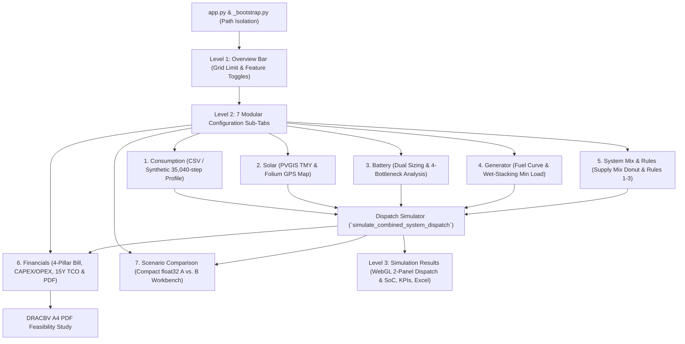

# :material/bolt: DRACBV Energy Simulator (Standalone Combined System Workbench)

A clean, self-contained, export-ready Streamlit application modeling coupled commercial **Grid + Solar PV + Battery Storage (BESS) + Peaking Generator** microgrids at **15-minute (35,040-interval/year)** resolution, including automated **4-Pillar Electricity Billing (DSO, Supplier, Metering, Statutory Levies)**, **15-Year Financial Evaluation**, **Side-by-Side Scenario Comparison**, **Excel (.xlsx)** verification export, and **DRACBV-Branded A4 PDF Feasibility Studies**.

This folder is completely isolated and portable: it can be moved, renamed, or zipped as-is without depending on any external parent repository.

---

## :material/rocket_launch: Quick Start & Local Execution

### 1. Prerequisites
* **Python 3.10+** (tested on Python 3.11 / 3.12 on Windows)
* *(Windows PDF Note)* The optional A4 PDF generator (`weasyprint`) relies on GTK/Pango runtime DLLs on Windows; all Streamlit views, physics simulations, charts, and Excel exports run out-of-the-box without GTK.

### 2. Install Dependencies
```bash
pip install -r requirements.txt
```

### 3. Launch the Application
* **Option A (Windows 1-Click):** Double-click `Start_DRACBV_Energy_Simulator.bat`
* **Option B (Terminal from this folder):**
  ```bash
  python -m streamlit run app.py
  ```

### 4. Run Standalone Verification Tests
```bash
python run_tests.py
```
`run_tests.py` verifies strict standalone path isolation (guaranteeing zero accidental imports from any surrounding folder) and runs all unit tests in `tests/test_combined_sandbox.py`.

---

## :material/folder_open: Complete Folder & Module Structure

```text
DRACBV_energy simulator/
├── app.py                                      # Standalone root Streamlit entrypoint
├── _bootstrap.py                               # Path & `current_model` package alias isolation
├── __init__.py                                 # Package marker
├── Start_DRACBV_Energy_Simulator.bat           # Windows 1-click launcher
├── requirements.txt                            # Exact Python dependencies
├── run_tests.py                                # Isolation check + automated test runner
├── README.md                                   # Complete system & developer handover guide
│
├── ui_sandbox/
│   ├── __init__.py                             # Minimal sandbox package initializer
│   ├── Combined_sandbox/                       # Main application workbench
│   │   ├── app.py                              # 3-Level Clean Screen orchestrator
│   │   ├── __init__.py                         # Package exports
│   │   ├── combined_sandbox_engine.py          # Public facade re-exporting `engine/*`
│   │   ├── combined_charts.py                  # Public facade re-exporting `charts/*`
│   │   ├── combined_excel_exporter.py          # On-demand 4/5-sheet .xlsx workbook exporter
│   │   ├── assets/                             # App icon (`combined_system.ico`) & DRACBV PDF images
│   │   │
│   │   ├── engine/                             # Physics, sizing, utilization, financials & formatting
│   │   │   ├── __init__.py                     # Engine exports
│   │   │   ├── models_and_presets.py           # `ENGINE_VERSION` ("13.7"), presets & dataclasses
│   │   │   ├── formatting.py                   # EU/Anglo formatting (`USE_EU_NUMBER_FORMAT` toggle)
│   │   │   ├── solar_and_sizing.py             # PVGIS yield, cluster kernel, Dual BESS & Gen sizing
│   │   │   ├── dispatch_simulation.py          # `@_opt_njit` 35,040-step coupled dispatch & SoC kernel
│   │   │   ├── utilization_and_tables.py       # Coordinated Mix optimizer, asset usage & tables
│   │   │   ├── tariff_presets.py               # Utility presets, Currentsituation sync & summaries
│   │   │   ├── cashflow_lifecycle.py           # Monthly TOU aggregation & 15Y NPV / IRR / LCOE
│   │   │   ├── financial_engine.py             # 4-Pillar & Single-Utility bills & congestion lock
│   │   │   ├── scenario_comparison_engine.py   # Compact `float32` A/B snapshots & restore sync
│   │   │   ├── scenario_tables_and_profiles.py # 5 scenario comparison ledger tables & adapters
│   │   │   ├── bess_phase_events.py            # Battery charge/discharge contiguous event extractor
│   │   │   └── solar_phase_events.py           # Solar direct/export contiguous event extractor
│   │   │
│   │   ├── charts/                             # Plotly WebGL & SVG chart builders
│   │   │   ├── __init__.py
│   │   │   ├── dispatch_and_mix_charts.py      # GPU WebGL (`Scattergl`) Dispatch+SoC & Mix charts
│   │   │   ├── phase_overlay_helpers.py        # Hover tooltips & phase event callout layers
│   │   │   ├── financial_overview_charts.py    # 15Y TCO, waterfall bridge & monthly cashflow
│   │   │   ├── financial_isolated_charts.py    # DSO, Supplier, Tax, Solar, BESS & Gen sub-charts
│   │   │   ├── scenario_comparison_charts.py   # Multi-scenario bar/trajectory comparison figures
│   │   │   └── scenario_profile_charts.py      # WebGL profile overlay & `sync_side_by_side_yaxis`
│   │   │
│   │   ├── views/                              # 3-Level Streamlit UI panels & `@st.fragment` blocks
│   │   │   ├── __init__.py
│   │   │   ├── state_and_helpers.py            # Session state schema, cache keys & widget sync
│   │   │   ├── level1_overview_bar.py          # Top bar: Grid Limit (kW), Peak Load & switches
│   │   │   ├── subtab1_consumption.py          # 1-Click scenarios + CSV/Synthetic load ingestion
│   │   │   ├── subtab2_solar.py                # GPS search, Folium map & PV sizing form
│   │   │   ├── subtab3_battery.py              # Mode A/B BESS sizing & 4-bottleneck diagnostics
│   │   │   ├── subtab4_generator.py            # Commercial generator models, fuel & min-load
│   │   │   ├── subtab5_mix_and_rules.py        # Supply mix donut, right-sizing presets & Rules 1-3
│   │   │   ├── subtab6_isolated_pillars.py     # Shared bill HTML ledgers & isolated pillar views
│   │   │   ├── subtab6_financials_bill_and_hardware.py # Sub-tab 6.1: Tariff form & Utility presets
│   │   │   ├── subtab6_hardware_costs.py       # Sub-tab 6.2: CAPEX/OPEX inputs & asset economics
│   │   │   ├── subtab6_financials_overview.py  # Sub-tab 6 orchestrator & 6.3 15Y TCO + PDF button
│   │   │   ├── subtab7_scenario_comparison.py  # Sub-tab 7: Side-by-side A/B/Baseline workbench
│   │   │   └── level3_master_output.py         # Always-visible dispatch chart, KPIs, phase logs & Excel
│   │   │
│   │   └── pdf_report/                         # Modular DRACBV A4 PDF Feasibility Study engine
│   │       ├── __init__.py
│   │       ├── templates_and_css.py            # Letterhead, watermark & print CSS pagination
│   │       ├── chart_snapshots.py              # Light-mode Kaleido PNG rasterizer for PDF charts
│   │       └── report_builder.py               # Structured multi-page A4 PDF report assembler
│   │
│   └── Currentsituation_sandbox/               # Reused Status Quo load & billing modules (pruned)
│       ├── __init__.py
│       ├── consumption/                        # CSV Inspector & Synthetic Load Simulator UI
│       └── engine/                             # 4-Pillar DSO, Supplier, Metering & Levy accounting
│
├── core/                                       # Pruned shared numerical & parsing engines
│   ├── bess_engine.py                          # Overload & violation cluster helpers
│   ├── csv_parser.py                           # Robust multi-encoding CSV load parser
│   ├── demo_scenario.py                        # Built-in reference consumer builders
│   ├── load_processor.py                       # 15-minute timestamp alignment & gap detection
│   ├── market_price_engine.py                  # EPEX Spot NL 2025 wholesale price loader
│   ├── metrics_engine.py                       # Load KPIs & duration metrics
│   ├── solar_engine.py                         # Open-Meteo geocoding & PVGIS TMY simulator
│   └── synthetic_engine.py                     # 24h & 365-day synthetic load aggregation
│
├── models/                                     # Pruned core domain dataclasses
│   ├── bess.py
│   ├── calendar_config.py
│   ├── contract.py
│   ├── financial.py
│   ├── load_component.py
│   ├── presets.py
│   └── solar.py
│
├── ui/common/                                  # Pruned Streamlit KPI cards, gap helpers & CSS
│   ├── cards.py
│   ├── session_utils.py
│   └── styles.py
│
├── sample_data/market_prices/                  # EPEX Spot NL 2025 dataset (for Dynamic Spot mode)
└── tests/test_combined_sandbox.py              # Automated verification tests (dispatch, finance, export)
```

---

## :material/account_tree: How the Program Works

### Architecture Diagram


### Data & Simulation Lifecycle
1. **Isolated Bootstrap (`_bootstrap.py`):** Before importing application modules, `bootstrap_standalone_root()` cleans parent directories off `sys.path` and maps `current_model` directly to this folder so imports work consistently anywhere.
2. **Baseline Load Profile (`Sub-Tab 1`):** Users pick a benchmark load profile, build a synthetic facility profile, or upload custom CSV/XLSX interval data. `LoadSeries2025` holds canonical 35,040 15-minute intervals plus an `is_gap` mask that prevents artificial zero-interpolation artifacts during data outages.
3. **Coupled 15-Minute Dispatch (`engine/dispatch_simulation.py`):** Given the active Grid Limit (kW) and component switches (Solar, Battery, Generator), `_execute_coupled_dispatch_arrays` (accelerated via Numba `@_opt_njit` when available) evaluates all 35,040 timesteps under **Rules 1-3**:
   * **Rule 1:** Grid Limit peak shaving priority (protect physical fuse / contracted capacity).
   * **Rule 2:** Daily battery optimization (`Peak Reserve SoC (%)` reservation for overload safety).
   * **Rule 3:** Battery charging sources (`Solar Only`, `Solar + Grid Recharge`, etc.).
4. **4-Pillar Financials & 15-Year TCO (`engine/financial_engine.py`, `engine/cashflow_lifecycle.py`):** Evaluates baseline (`Current Situation`) vs. upgraded grid imports across DSO (regulated transport + peak demand + breach step-up), Energy Supplier (Flat / HT-NT Dual TOU / Spot), Certified Metering, and Statutory Levies, combining hardware CAPEX, OPEX, fuel costs, avoided grid upgrade credit, escalation, and discounting (NPV, IRR, Payback Period).
5. **High-Speed Visuals & Exports (`charts/dispatch_and_mix_charts.py`, `combined_excel_exporter.py`, `pdf_report/`):** Renders GPU WebGL (`go.Scattergl`) 2-panel time-series in `np.float32` buffers, generates multi-sheet `.xlsx` audit workbooks on demand, and renders multi-page DRACBV A4 PDF feasibility studies.

---

## :material/code: Developer Handover & Configuration Notes

### 1. Number Formatting Toggle (`USE_EU_NUMBER_FORMAT`)
All rendered tables, KPI cards, HTML ledgers, Plotly charts, and PDF exports default to European number grouping (`1.234,56`) via [`ui_sandbox/Combined_sandbox/engine/formatting.py`](ui_sandbox/Combined_sandbox/engine/formatting.py).
* **1-Line Switch Back to US/Anglo Formatting (`1,234.56`):** Set `USE_EU_NUMBER_FORMAT: bool = False` in `ui_sandbox/Combined_sandbox/engine/formatting.py`.
* Raw floats inside `openpyxl` `.xlsx` cells and Streamlit `st.number_input` widgets intentionally stay numeric so spreadsheets calculate reliably.

### 2. Extending the Application
* **Add or edit physical/financial formulas:** Modify the corresponding module under `ui_sandbox/Combined_sandbox/engine/` and keep public symbols re-exported via `engine/__init__.py` and `combined_sandbox_engine.py`. When dispatch outputs or cached tuple schemas change, bump `ENGINE_VERSION` in `engine/models_and_presets.py` so Streamlit session caches auto-invalidate cleanly.
* **Modify UI tabs without slowing dispatch:** Heavy charts, tariff forms, and exporters sit inside `@st.fragment` blocks in `ui_sandbox/Combined_sandbox/views/` so user edits do not trigger unnecessary full-page reruns.
* **Validate changes:** Always run `python run_tests.py` after editing engine or UI code.
