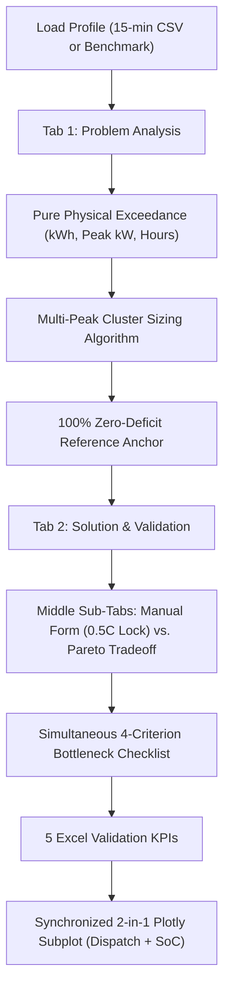

# BESS Peak Shaving & Sizing Laboratory (Physics-First Architecture)

A dedicated, isolated Streamlit engineering decision laboratory located at `ui_sandbox/BESS_sandbox/`.
It allows testing, sizing, and validating Battery Energy Storage System (BESS) peak shaving feasibility and multi-peak cluster physics without interacting with the main production workflow or navigating through multi-scenario setups.

---

## 1. Quick Start

Run the sandbox directly in isolated mode:

```bash
python -m streamlit run "ui_sandbox/BESS_sandbox/app.py"
```

---

## 2. Architecture & File Structure

```text
ui_sandbox/BESS_sandbox/
├── __init__.py               # Package exports: render_bess_sandbox, tab views, engines, presets, charts
├── app.py                    # Main standalone Streamlit coordinator (2 physics tabs + benchmark switcher)
├── baseline_presets.py       # Pre-configured Dutch industrial, commercial & Paula WKO benchmark profiles
├── sandbox_bess_engine.py    # Physics sizing engine: multi-peak clusters, simultaneous bottlenecks & Pareto tradeoff
├── sandbox_charts.py         # Sandbox-local Plotly figures (synchronized 2-in-1 dispatch/SoC & Pareto hockey stick)
├── view_problem.py           # Tab 1: Current Situation & 1:1 CSV Ingestion & Validation Pipeline
├── view_technical.py         # Tab 2: BESS Sizing & Excel Validation (4 structured blocks)
├── view_financial.py         # Preserved for Step 2: Financial Comparison & 15Y TCO (Avoided grid upgrade vs. BESS)
├── view_optimizer.py         # Optional / Parametric capacity sweep & sensitivity library
├── data/
│   └── Paula3_totaal_clean.csv # Standardized 28-day 15-min benchmark CSV (Peak: 131.4 kW, Limit: 110 kW)
└── README.md                 # Complete sandbox documentation
```

---

## 3. Core Physics Workflow & The 2-Tab Architecture

The sandbox focuses strictly on **electrical and battery physics**: proving whether a BESS configuration can eliminate all grid overloads above the contracted limit before evaluating financial metrics.



---

### Tab 1: Current Situation & Load Ingestion (`view_problem.py`)

- **1:1 Industrial-Grade CSV Load Ingestion Pipeline:**
  - **Multi-Format & ZIP Decompression:** Ingests `.csv`, `.txt`, and compressed `.zip` archives with in-memory decompression and multi-encoding fallback (`utf-8`, `utf-8-sig`, `latin1`, `cp1252`).
  - **1-Click Demo Generator:** `:material/play_circle: Load 15-Min Demo CSV (Full Year 2025)` generating a realistic 35,040-interval commercial load profile.
  - **Table Inspector & Dynamic Header Skip:** Live `skiprows` control (0–50 rows) with head(15) preview for utility meter files with preamble metadata.
  - **Column Auto-Detection & Multi-Meter Aggregation:** `detect_suggested_columns` heuristic for timestamp and power columns; supports multi-channel meter summing into `Total_Demand_kW`.
  - **4 Unit Conversion Modes:** `kWh (15-min) → kW` ($\times 4.0$), `kW Direct`, `W → kW` ($/ 1,000$), `kWh (Hourly) → kW`.
  - **Day-First Format Sniffer & Live Preview:** Automatic year-first vs. day-first regex detection (`^\s*\d{4}[./-]`), day-first toggle (`DD.MM`), and live formatted timestamp sample caption.
  - **Day-Accurate Date Range Filter:** Inclusive Start Date and End Date calendar pickers (`DD.MM.YYYY`) with chronological validation (`start_date > end_date` check).
  - **Time Series Gap & Continuity Detection:** `detect_load_profile_gaps` flags missing intervals (> 3 steps) with start/end timestamps and duration.
  - **Multi-Year Timeseries Notice:** Informs users when recordings exceed 366 calendar days and explains baseline vs. annualized life-cycle handling.
  - **Cleaned Data Preview Expander:** Expandable table displaying the normalized 15-minute timeseries dataframe.
  - **Session State Persistence:** Synchronizes `bess_sb_custom_df`, `bess_sb_custom_filename`, `active_csv_df`, and `active_csv_filename`.
- **Contracted Grid Limit Controls:**
  - Quick limit callback buttons (`147 kW (Liander AC4b)`, `150 kW (Enexis MS-D)`, `430 kW (Industrial Medium)`) utilizing pre-render `on_click` callbacks to avoid widget instantiation race conditions.
  - Numeric input for arbitrary custom grid limits with instant delta calculations.
- **4 Purified Problem KPI Cards (Pure Physics - No Battery Assumptions):**
  1. `Peak Facility Demand`: Highest observed 15-minute load (kW) and delta above grid limit.
  2. `Peak Overload Above Limit`: Maximum instantaneous overload requiring peak shaving (kW).
  3. `Total Overload Duration`: Total annual hours above the limit and percentage of the year.
  4. `Total Exceedance Energy (kWh)`: Pure physical integral $\int \max(0, P_{\text{load}} - P_{\text{limit}}) dt$ (kWh/yr) and share of total facility consumption.
- **Grid Violation Preview Chart:**
  - Full-year interactive load profile highlighting red exceedance areas above the limit with custom range selector buttons (1D, 7D, 1M, Full Year).

---

### Tab 2: BESS Sizing & Excel Validation (`view_technical.py`)


Tab 2 is organized into **4 structured blocks**:

#### Block 1: 100% Zero-Deficit Reference Box
- Displays the exact minimum battery sizing required to eliminate 100% of grid overloads (reproducing the Excel multi-peak cluster sizing methodology).
- Metrics:
  - `Min. Required Gross Capacity`: $E_{\text{gross}} = \frac{E_{\text{usable}}}{\text{DoD}}$ (kWh).
  - `Min. Required Usable Buffer`: Multi-peak consecutive deficit accumulation (kWh).
  - `Min. Required Discharge Power`: Peak overload $P_{\text{peak}} - P_{\text{limit}}$ (kW).
  - `Min. Inverter Recharge Power`: Minimum charging power required between consecutive peak events (kW).
  - `Recommended Modular Units`: Sized based on unit capacity.
- Action: `:material/auto_fix: Apply Exact Minimum Sizing (0.0 kWh Deficit)` button to instantly populate the interactive configuration form.

#### Block 2: Middle Interactive Sub-Tabs
- **Sub-Tab A: Manual Sizing Form & 0.5C Sizing Lock:**
  - Enclosed in an `st.form` to prevent UI thrashing and excessive recalculations during rapid slider/input changes.
  - **0.5C Sizing Lock (2h Duration Coupling):** When toggled, automatically calculates continuous inverter discharge and charge power as $\text{Gross Capacity} \times 0.5$, ensuring industrial standard battery C-rates.
  - Unit count and unit capacity controls.
  - Operational boundaries: $\text{SoC}_{\min} (\%)$, $\text{SoC}_{\max} (\%)$, and Round-Trip Efficiency ($\%$).
- **Sub-Tab B: Interactive Pareto Tradeoff Curve:**
  - Displays the coverage hockey-stick curve of required battery capacity (kWh) and inverter power (kW) across target exceedance energy coverages ($50\%$ to $100\%$).
  - Identifies the economic knee-of-the-curve where $80\text{--}90\%$ of peak overload energy can be shaved with a fraction of the capacity required for rare multi-day clusters.
  - Highlights current user sizing against the Pareto optimal frontier.

#### Block 3: Feasibility Diagnosis & Simultaneous Bottleneck Audit
- **Simultaneous 4-Criterion Bottleneck Checklist:**
  Evaluates all 4 physical constraints simultaneously in isolation (no short-circuiting or early exit on failure):
  1. `:material/battery_charging_full:` **Grid Recharge Headroom:** Evaluates whether total annual headroom below the grid limit can recharge the annual exceedance energy (including round-trip efficiency losses).
  2. `:material/bolt:` **Inverter Discharge Power:** Evaluates whether rated discharge power meets or exceeds the highest 15-minute overload.
  3. `:material/battery_horiz_075:` **Storage Capacity (Multi-Peak Clusters):** Evaluates whether gross capacity covers the worst multi-day consecutive deficit cluster under ideal recharge.
  4. `:material/sync:` **Recharge Inverter Power:** Evaluates whether charging power can replenish the buffer in the short lulls between consecutive peaks.
  - Each item displays status badges (`:material/check_circle: PASSED`, `:material/cancel: BOTTLENECK`, `:material/warning: WARNING`), configured value, required value, and engineering margin.
- **The 5-Metric Excel Validation Block:**
  1. `Battery Capacity`: Gross nameplate kWh and effective usable buffer.
  2. `Battery Power`: Continuous discharge kW and charge kW.
  3. `Max Grid Import`: Observed grid import kW vs contracted limit.
  4. `Observed SoC Range`: Min % – Max % and minimum kWh reached.
  5. `Remaining Deficit (Excel 'Generator')`: Total unserved deficit (kWh/yr) and residual peak deficit (kW).

#### Block 4: Synchronized 2-in-1 Plotly Subplot (`create_synced_dispatch_soc_figure`)
- Single unified figure combining the 15-minute power dispatch (top panel, 62% height) with the battery State of Charge envelope (bottom panel, 38% height).
- **Shared X-Axes (`shared_xaxes=True`):** Panning or zooming on one panel automatically synchronizes the other.
- **Single Range Slider & Selectors:** One range slider at the bottom drives both panels synchronously.
- **Peak Focus Auto-Zoom:** Automatically centers on the annual peak overload week on initial load.
- Top panel displays: Facility Load (grey), Grid Import (blue), BESS Discharge (green fill), BESS Charge (cyan fill below baseline), and Remaining Unmet Deficit (bold red area).
- Bottom panel displays: State of Charge % (purple trace with dashed $\text{SoC}_{\min}$ / $\text{SoC}_{\max}$ limits) and stored energy in kWh on secondary y-axis.

---

## 4. Benchmark Presets

1. **Case 1: Liander Industrial Peak Shaving (AC4b Connection)**
   - Facility Load: 350 kW peak manufacturing profile with intermittent high-demand machinery cycles.
   - Grid Limit: Contracted connection capped at 147 kW.
   - Zero-Deficit BESS Sizing: ~203 kW / ~485 kWh LFP system.

2. **Case 2: Enexis Commercial Facility (MS-D Tariff)**
   - Facility Load: 250 kW peak commercial logistics building.
   - Grid Limit: Contracted capacity capped at 150 kW.
   - Zero-Deficit BESS Sizing: ~100 kW / ~240 kWh LFP system.

3. **Case 3: Paula Dutch Site (28-Day WKO / 110 kW Contract Limit)**
   - Facility Load: 28-day 15-minute interval WKO heat pump / aquifer thermal storage profile (2,688 intervals) with 131.4 kW peak.
   - Grid Limit: Contracted capacity capped at 110.0 kW.
   - Overload Peak: +21.4 kW unmitigated peak above limit.
   - Purpose: Direct 1:1 validation against Paula's Excel model benchmarks and remaining deficit quantification.

4. **Custom CSV Ingestion:**
   - Ingests arbitrary 15-minute load CSV data uploaded by the user with automatic column sniffing and unit conversion.

---

## 5. Architectural Isolation & Quality Standards

- **Strict One-Way Dependency:** `ui_sandbox/BESS_sandbox/` may import from `core/`, `models/`, and `ui/`.
- **Production Guard:** Core production modules (`core/`, `models/`, `ui/`, and root `app.py`) **MUST NEVER** import from `ui_sandbox/`.
- **Zero Cartoon Emojis:** Strictly uses Streamlit's native Google Material Symbols (`:material/<icon_name>:`).
- **English UI Text:** All UI text, charts, labels, and docstrings are strictly in English.
- **Regression Suite:** Covered by unit tests in `tests/test_ui_sandbox.py` covering exceedance calculations, simultaneous bottleneck audits, Pareto curves, and synced charts.

